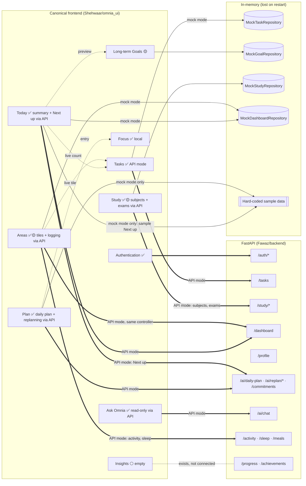

# Current Status

A snapshot verified against the source, not against the README. Back to [[00 - OMNIA|OMNIA]].

> [!summary] In one line
> **In API mode, authentication, Tasks, the profile and daily targets, the Today/Areas day summary (`/dashboard`), today's activity and sleep logs, Study subjects and exams, the daily plan (with fixed commitments, plan preferences and adaptive replanning) and the read-only Ask Omnia assistant are real (FastAPI). Goals and Focus are local; Insights, nutrition and social are not connected. No screen shows sample data in API mode.** In mock mode, nothing talks to a server and the labelled sample day is shown.
>
> Phases 3 (Tasks), 4 (Dashboard), 5A (Profile and daily targets), 5B (Activity and sleep), the UX architecture pass, Study V1, Ask Omnia, 5C (daily plan), OmniAI planning and availability, and adaptive replanning are committed on `main` (see [[Roadmap]] for commits). The release-readiness work (deterministic backend tests, a working CI workflow, these docs) is in progress; see [[Roadmap]].

## Feature integration map

Thick arrow = wired today. Dotted arrows to the backend = the backend endpoint exists, but the canonical frontend doesn't call it.

## Status table

| Area | Status | Data source today | Backend support | Note |
|---|---|---|---|---|
| [[Authentication Flow\|Authentication]] | `api-connected` | FastAPI `/auth/*` | [[Authentication API]] | Manually verified on the Android emulator (per README) |
| [[Tasks]] | `api-connected` (API mode) | `ApiTaskRepository` (API mode) · `MockTaskRepository` (mock mode) | [[Tasks API]] full CRUD | [[Phase 3 - Tasks API Integration]]: complete (automated + manual emulator verification) |
| [[Goals]] (long-term) | `local-functional` | `MockGoalRepository` (API mode: starts empty, labelled "not synced") | ❌ none | Not the same as [[Daily Targets]] |
| [[Focus]] | `local-functional` | `FocusTimerController` (app-wide, not stored) | `/study/sessions` could log time | Intentionally app-wide |
| [[Study]] | `partial` | API mode: subjects and upcoming exams via `/study/subjects`, `/study/exams` (Study V1, `8601ba0`); study minutes and next exam from `/dashboard`. Sample data and the revision session in mock mode only | [[Study API]] | Backlog, sessions and the study plan endpoint not wired |
| [[Dashboard]] (Today) | `partial` | API mode: greeting, name, date, next exam and Study/Activity/Sleep from `/dashboard`. Mock mode: `MockDashboardRepository` (the sample day). Tasks card and Goals preview unchanged. API mode: Next up comes from today's daily plan ("No plan yet." with an Open Plan action when none exists); mock mode keeps the labelled sample. | [[Profile and Dashboard API]] | [[Phase 4 - Dashboard API Integration]]: complete (automated + manual emulator verification) |
| [[Plan]] | `api-connected` (API mode) · `sample` (mock) | API: `ApiPlanRepository` (`GET`/`POST /ai/daily-plan`), fixed commitments and availability (`/commitments`), plan preferences (`/profile`), "Why?" explanation, and "Adjust today's plan" (`/ai/replan/proposals`, explicit Apply/Cancel). Mock: `samplePlan` constant | [[AI API]] | 5C complete (`8029231`, `a22ac4d`); adaptive replanning `1d87602`. Plan-block completion/outcomes are not persisted yet |
| [[Areas]] (was Track) | `partial` | Study/Tasks/Goals/Activity/Sleep tiles from the session controllers; each opens its area ([[Phase 5B - Activity and Sleep Logging]] for the logs) | `/dashboard`; [[Activity API]], [[Sleep API]] | No meals logging |
| [[Insights]] | empty | "No insights yet" (mock mode labelled `SAMPLE DATA`) | [[Progress API]] | Not connected |
| [[Settings]] | `api-connected` (account section) | Theme local; account and profile via `AuthController` | [[Authentication API]], [[Profile and Dashboard API]] | Account section and "Profile & daily targets" only in API mode |
| [[Daily Targets]] | `api-connected` (API mode) | Edited in Settings → "Profile & daily targets" (`PATCH /profile`); shown as the card and tile targets from `/dashboard` | `/profile`, `/dashboard` | [[Phase 5A - Profile and Daily Targets]]: complete (automated + manual emulator verification) |
| [[Nutrition]] | `planned` | None | [[Nutrition API]] | Backend exists; no frontend yet |
| Social | `planned` | None | [[Social API]] | Backend exists; no frontend yet |
| [[AI Assistant]] | `api-connected` (read-only) | Ask Omnia: `ApiAssistantRepository` (`POST /ai/chat`), context-aware answers | [[AI API]] | Cannot change data or apply plans; AI planning itself lives in [[Plan]] |
| [[Achievements and Life Timeline]] | `planned` | None | `/achievements` (fixed list) | Life Timeline is vision only |

## Mode matrix

See [[Mock vs API Mode]].

| | Mock mode (`flutter run`) | API mode (`--dart-define=OMNIA_DATA=api`) |
|---|---|---|
| Sign-in | None | Real (FastAPI) |
| Tasks | In-memory, one session for app life | **FastAPI `/tasks`**, scoped to the signed-in user |
| Goals | In-memory sample goals, one session for app life | In-memory, **starts empty** per signed-in user |
| Study | Sample subject, exam and revision session (labelled) | **FastAPI `/study/subjects`, `/study/exams`**, per user; revision session hidden |
| Focus | App-wide, local | App-wide, local |
| Today / Areas day summary | Sample (`MockDashboardRepository`, steps and sleep from the shared mock track state) | **FastAPI `/dashboard`**, per user |
| Today's activity and sleep logs | In-memory `MockTrackRepository` (seeded with the sample day) | **FastAPI `/activity/{day}`, `/sleep/{day}`**, per user |
| Plan | Sample (labelled) | **FastAPI `/ai/daily-plan`**, `/commitments`, `/ai/replan/*`, per user |
| Ask Omnia | Canned local answers | **FastAPI `/ai/chat`** (read-only) |
| Insights | Sample (labelled) | Empty state, never sample |

## What "verified" means here

- Wiring was read from `lib/app.dart`, `lib/core/session.dart` and `lib/core/app_dependencies.dart`: `AppDependencies.mock()` is used in mock mode and `AppDependencies.api(api)` for signed-in sessions in API mode (Tasks and the dashboard).
- Sample content is gated by `AppDependencies.sampleContent` (true only in mock mode); screens were checked for their on-screen labels (`SAMPLE DAY`, `SAMPLE DATA`) and the `samplePlan` constant.
- The emulator check of authentication is recorded in `Shehwaar/README.md`. It was not re-run while building this vault.
