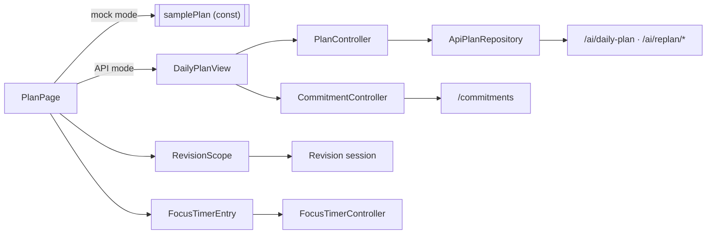

# Plan

## Purpose

The day's schedule, eventually an adaptive daily plan that reacts to sleep, exams, tasks and more.

## Current Status

**API mode: connected** (5C, `8029231` and `a22ac4d`; adaptive replanning `1d87602`). `DailyPlanView` loads today's plan with `GET /ai/daily-plan` and generates a suggestion with `POST /ai/daily-plan`. Fixed commitments come from `/commitments` and are shown on the timeline; planning hours and the 12/24-hour format are plan preferences on the profile. "Why?" opens a short explanation. Each block has a check-off square inside the card on the right: neutral until recorded, then green ✓ done, yellow – partly done, or red × not done. A study block marked done is logged as study time for its subject and planned length; partly done asks for the minutes studied; Focus time inside the block isn't counted twice (backend `app/modules/ai/study_credit.py`). On today's plan, **Adjust today's plan** asks for a change, shows a compact "Plan changes" preview (one action-and-title line per change) and changes nothing until **Apply** succeeds (`/ai/replan/proposals`, then `/apply`); **Cancel** dismisses the proposal. Today's "Next up" reads the same plan. Plan-block completion and outcomes are **not** persisted yet (see [[Roadmap]]). No sample schedule is ever shown in API mode.

**Mock mode: `sample`.** Timeline and list views of a **fixed sample day** (`samplePlan` in `features/plan/plan_item.dart`, labelled `SAMPLE DAY`). Two parts are live:

- The **revision** item opens the real [[Study]] revision session and shows its current title.
- The **Focus** entry (`FocusTimerEntry`) shows the live app-wide [[Focus]] timer.

Other items open an info dialog: "This is a sample plan item. Editing and scheduling other activities are coming soon." Rescheduling is explicitly marked as not implemented.

## Current Frontend

`features/plan/plan_page.dart` (mock-mode sample day, and the switch to `DailyPlanView` in API mode), `widgets/daily_plan_view.dart`, `plan_controller.dart`, `commitment_controller.dart`, `plan_preferences_page.dart`, `replan_change_format.dart`, `plan_item.dart`, `widgets/timeline_row.dart`.

## State / Controller

API mode: `PlanController` (session-owned plan snapshots, date selection, replan proposal lifecycle) and `CommitmentController`. Mock mode: the `const` sample list. The revision title comes from `RevisionScope`, the timer from `FocusTimerScope`.

## Backend

[[AI API]]: `POST /ai/daily-plan` (get or generate, with `regenerate` and an optional note like "slept badly") and `GET /ai/daily-plan?date=`. The plan is built by a **rule-based provider by default**. An Anthropic provider is optional and configured server-side, and it falls back to rules on failure. The [[Study API]] also offers `GET /study/plan` (a multi-day study allocation).

Replanning: `POST /ai/replan/proposals` (never changes the plan), `GET /ai/replan/proposals/{id}`, `POST …/apply` (explicit, owner-scoped, creates the next immutable plan revision) and `POST …/dismiss`. See `Fawaz/backend/docs/adaptive-replanning.md`.

## Data Flow

## Related Features

[[Focus]] · [[Study]] · [[Tasks]] · [[Dashboard]] · [[AI Assistant]] · [[Sleep and Recovery]]

## Future Direction

Next: persist plan-block completion and outcomes so replanning can learn what actually happened; let Ask Omnia start the existing replan flow while keeping explicit approval. Later, cross-domain replanning (vision): see [[AI Roadmap]].
