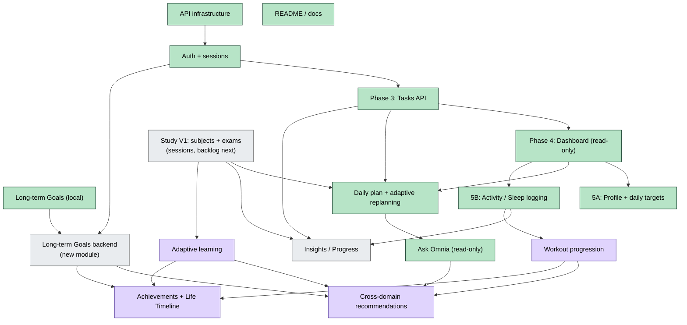

# Roadmap

Intended order with dependencies. **No dates** are set. Sources: `Shehwaar/README.md` roadmap plus the dependency analysis in this vault.

## Completed checkpoints

| Checkpoint | Commit | What it delivered |
|---|---|---|
| Long-term Goals | `d1e908a` | Measurable and completion-only goals, form, Home preview, tests |
| API infrastructure | `10e8ad2` | `ApiClient`, `ApiConfig`, `ApiException`, JSON helpers, `TokenStore`, Android network config, client tests |
| Authentication and sessions | `70864a7` | `AuthController`, auth screen, Settings account, `UserSession`, fake auth backend tests |
| Frontend documentation | `527020e` | `Shehwaar/README.md` rewrite |
| Tasks API integration | `e141846` | `ApiTaskRepository`, `AppDependencies.api`, `/tasks` fake backend, tests. Automated and manual emulator verification passed. |
| Dashboard API integration (read-only) | `fc125e2` | `DashboardRepository` (mock + API), `DashboardController`, Home and Track summary, `/dashboard` fake backend, tests. Automated and manual emulator verification passed. |
| Profile and daily targets (5A) | `e822b4b` | `Profile` model, `AuthController.updateProfile`, Settings "Profile & daily targets", `/profile` fake backend, tests. Automated and manual emulator verification passed. |
| Activity and sleep logging (5B) | `0375257` | `TrackRepository` (mock + API), `TrackController`, Activity and Sleep log screens, card navigation, `/activity` and `/sleep` fake backend, tests. Automated and manual emulator verification passed. |
| UX architecture pass | `46cbfa0` | Today · Plan · Areas · Insights, per-tab stacks, no sample data in API mode, selection-over-typing, Archivo/Space Mono. See [[Navigation and Information Architecture]]. |
| Study V1 | `8601ba0` | Subjects and exams through `/study/subjects` and `/study/exams` in API mode |
| Ask Omnia | `ed47dac` | Read-only, context-aware assistant (`POST /ai/chat`); it answers questions but never changes data |
| Daily plan (5C) | `8029231` | Validated daily plan from `/ai/daily-plan` (load and generate) on Plan and Today's "Next up"; "Why?" explanation |
| OmniAI planning and availability | `a22ac4d` | AI-assisted planning with a deterministic rules fallback; fixed commitments and availability (`/commitments`); planning hours and time format in plan preferences |
| OpenRouter and PWA | `e587914`, `5c7ac64` | OpenRouter provider option, web/PWA build, PostgreSQL boolean migration fix |
| Legacy frontend removed | `0d1ddf9` | `Fawaz/lib` deleted; `Shehwaar/omnia_ui` is the only frontend |
| Adaptive replanning | `1d87602` | "Adjust today's plan": backend-validated proposals, explicit Apply/Cancel, immutable plan revisions, stale/expiry checks |
| UI polish and project README | `edf353f` | Current visual pass and repository README |

These were built on the Tasks, Focus, onboarding and design work in the canonical frontend that came before them. See [[Git Checkpoints]].

## Open TODOs

- [ ] **Verify the release foundation.** Implementation and local verification are complete (October 11, uncommitted): deterministic backend tests, corrected user-local export dates, root CI workflow, and documentation alignment are in place. Local checks passed: 247 backend tests across three host-date offsets; Ruff; SQLite migrations up/check/down/up; Flutter analysis and 344 tests; web release build. Still open: push the workflow and confirm the first GitHub Actions run is green, including PostgreSQL tests and migrations (not run locally).
  - [x] Deterministic backend tests (October 11, uncommitted): one frozen clock for the whole suite (`tests/conftest.py`), dates taken from it rather than the host, and guard tests in `tests/test_clock.py`. The 11 failures reproduce on the old tests whenever the host's date differs from UTC; the suite now passes with the host clock a day behind, on, and a day ahead of UTC. The data export's `exported_on` now uses the user's day too.
  - [x] CI replaced (uncommitted): `.github/workflows/ci.yml` runs Ruff (lint and format), backend tests on SQLite and PostgreSQL, migrations up/check/down/up on both databases, `flutter analyze`, `flutter test` and the web release build. `tests/test_ci_workflow.py` keeps those gates in place. The broken `backend-ci.yml` and the inert `Fawaz/.github` workflow were removed.
  - [x] Status and roadmap documentation aligned with the code ([[Current Status]], this page, `Shehwaar/README.md`).
  - [ ] Confirm the first GitHub Actions run is green. The PostgreSQL steps have not been run locally.
- [ ] **Finish product and release basics.** Replace the canonical `Shehwaar/omnia_ui` second onboarding placeholder (“Next onboarding page” / “This space is reserved for the next onboarding step”) with the real step, copy, and CTA; persist onboarding completion; configure a real Android application ID and release signing; persist plan-block completion/outcomes so replanning can learn what actually happened; then run a PostgreSQL/emulator end-to-end pass covering plan generation, concurrent edits, proposal expiry, stale proposals, and account switching.
- [ ] **Harden production operations.** Move migrations out of container startup into a controlled release step; add error reporting and AI-provider latency/fallback plus replan lifecycle metrics; decide whether 12-hour tokens without refresh are acceptable; replace the in-memory rate limiter before multi-instance deployment; document backup, rollback, migration, and secret-rotation procedures.
- [ ] **Close the remaining data gaps, in order.** (1) Long-term Goals backend and synchronization; (2) persisted focus sessions and study-minute logging; (3) frontend nutrition logging using the existing backend; (4) real Insights/Progress screens; (5) achievements based on genuine history.
- [ ] **Expand the AI loop only after the data foundation is dependable.** Let Ask Omnia initiate the existing replan proposal flow while retaining explicit approval; ground explanations in actual plan changes and outcomes; add cross-domain rules for poor sleep, imminent exams, missed tasks, and recovery; only then build adaptive learning (flashcards, quizzes, mastery, weak-topic detection) and broader learned recommendations.

Planning note: follow this order and resist adding more AI surface area before CI is trustworthy, documentation is aligned, plan outcomes are persisted, and the core data loop is complete. Source: the release-readiness assessment provided October 11, 2026.

## Dependency graph

Green = done · Yellow = next · Grey = integration phases · Purple = product vision. The AI loop beyond the read-only assistant and replanning (cross-domain rules, learning) is still vision.

## Sequence

1. **[[Phase 3 - Tasks API Integration]]** (complete)
2. **[[Phase 4 - Dashboard API Integration]]**: `/dashboard` on Home and Track, read-only (complete)
3. **[[Phase 5A - Profile and Daily Targets]]**: `PATCH /profile` from Settings (complete)
4. **[[Phase 5B - Activity and Sleep Logging]]** from Today and Areas (complete)
5. **5C Daily plan**: `/ai/daily-plan` on Plan and Today, with availability, preferences and adaptive replanning (complete)
6. **Study integration** (V1 complete: subjects and exams; sessions, backlog and persisted focus time remain), then the [[Adaptive Learning Roadmap]]; after 5B, the [[Fitness Roadmap]]
7. **Insights and progress** from real data
8. **Long-term Goals backend**. This is independent of 2–7 and can be scheduled whenever needed.
9. **[[AI Assistant]]**: Ask Omnia is live and read-only; next it may start the existing replan flow with explicit approval. Then cross-domain recommendations ([[AI Roadmap]])
10. **[[Achievements and Life Timeline]]**

Details per integration phase: [[Backend Integration Roadmap]].

Up: [[00 - OMNIA|OMNIA]] · status today: [[Current Status]]
