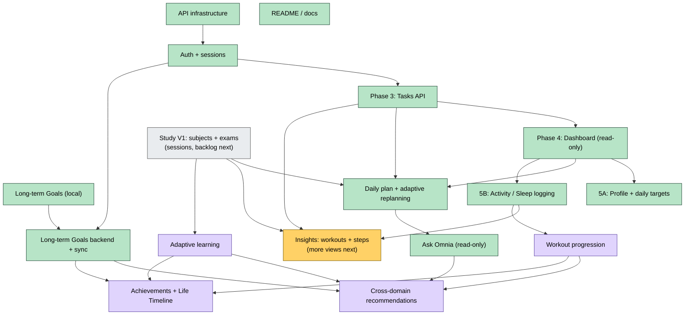

# Roadmap

Intended order with dependencies. **No dates** are set. Sources: `Shehwaar/README.md` roadmap plus the dependency analysis in this vault.

## Completed checkpoints

| Checkpoint | Commit | What it delivered |
|---|---|---|
| Long-term Goals | `d1e908a` | Measurable and completion-only goals, form, Home preview, tests |
| API infrastructure | `10e8ad2` | `ApiClient`, `ApiConfig`, `ApiException`, JSON helpers, `TokenStore`, Android network config, client tests |
| Authentication and sessions | `70864a7` | `AuthController`, auth screen, Settings account, `UserSession`, fake auth backend tests |
| Frontend documentation | `527020e` | `Shehwaar/README.md` rewrite |
| Tasks API integration | `e141846` | `ApiTaskRepository`, `AppDependencies.api`, `/tasks` fake backend, tests. Automated and manual emulator verification passed. |
| Dashboard API integration (read-only) | `fc125e2` | `DashboardRepository` (mock + API), `DashboardController`, Home and Track summary, `/dashboard` fake backend, tests. Automated and manual emulator verification passed. |
| Profile and daily targets (5A) | `e822b4b` | `Profile` model, `AuthController.updateProfile`, Settings "Profile & daily targets", `/profile` fake backend, tests. Automated and manual emulator verification passed. |
| Activity and sleep logging (5B) | `0375257` | `TrackRepository` (mock + API), `TrackController`, Activity and Sleep log screens, card navigation, `/activity` and `/sleep` fake backend, tests. Automated and manual emulator verification passed. |
| UX architecture pass | `46cbfa0` | Today · Plan · Areas · Insights, per-tab stacks, no sample data in API mode, selection-over-typing, Archivo/Space Mono. See [[Navigation and Information Architecture]]. |
| Study V1 | `8601ba0` | Subjects and exams through `/study/subjects` and `/study/exams` in API mode |
| Ask Omnia | `ed47dac` | Read-only, context-aware assistant (`POST /ai/chat`); it answers questions but never changes data |
| Daily plan (5C) | `8029231` | Validated daily plan from `/ai/daily-plan` (load and generate) on Plan and Today's "Next up"; "Why?" explanation |
| OmniAI planning and availability | `a22ac4d` | AI-assisted planning with a deterministic rules fallback; fixed commitments and availability (`/commitments`); planning hours and time format in plan preferences |
| OpenRouter and PWA | `e587914`, `5c7ac64` | OpenRouter provider option, web/PWA build, PostgreSQL boolean migration fix |
| Legacy frontend removed | `0d1ddf9` | `Fawaz/lib` deleted; `Shehwaar/omnia_ui` is the only frontend |
| Adaptive replanning | `1d87602` | "Adjust today's plan": backend-validated proposals, explicit Apply/Cancel, immutable plan revisions, stale/expiry checks |
| UI polish and project README | `edf353f` | Current visual pass and repository README |

These were built on the Tasks, Focus, onboarding and design work in the canonical frontend that came before them. See [[Git Checkpoints]].

## Open TODOs

Status as of October 11, 2026. Items marked done below are implemented and verified locally (uncommitted); nothing here has been deployed.

- [ ] **Verify the release foundation.**
  - [x] Deterministic backend tests: one frozen clock for the whole suite (`tests/conftest.py`), guarded by `tests/test_clock.py`; passes with the host clock a day behind, on, and a day ahead of UTC.
  - [x] CI replaced: `.github/workflows/ci.yml` (Ruff, backend tests on SQLite and PostgreSQL, migrations up/check/down/up on both, `flutter analyze`, `flutter test`, web release build), guarded by `tests/test_ci_workflow.py`.
  - [x] The first GitHub Actions run (#38130470928, commit `da37db7`) failed only at **Tests (PostgreSQL)**: the `commitments.enabled` model default was the integer `1`, which PostgreSQL rejects for a boolean. Fixed (`server_default=true()`) with a guard test in `tests/test_migrations.py`. Re-verified locally against PostgreSQL 16.2: the full backend suite passes and migrations run up, check, down and up. Actions bumped to `checkout@v5` / `setup-python@v6` (the run warned about Node 20).
  - [ ] Push and confirm the next GitHub Actions run is green. This needs a push; no CI run has passed yet.
- [ ] **Finish product and release basics.**
  - [x] Onboarding: the placeholder page is replaced by "How Omnia works" (three steps that describe only built features), with Skip/Back, reduced motion, light/dark and narrow/200% text covered by tests. Completion is saved on the device (`SecureOnboardingStore`, read before the first frame in `main.dart`) when the intro is skipped or finished, or when a stored sign-in is restored; it is per device, not per account.
  - [x] Plan-block outcomes: each block can be marked done, partly done or skipped (`PUT`/`DELETE /api/ai/daily-plan/{date}/items/{item_key}/outcome`, migration `0008`). Outcomes follow the block's stable key through replans, take the planning lock (a proposal made before an outcome change becomes stale), are owner-scoped, and can't be set for future days. Replanning reads them: done work isn't planned again and isn't required by validation; partly done and skipped work still is. Today's "Next up" skips done and skipped blocks.
  - [x] Check-off control inside each plan block (October 11, uncommitted): a rounded square on the right of the card, vertically centred — neutral and unfilled until something is recorded, then green ✓ (done), yellow – (partly done) or red × (not done). Tested for placement, colours, menu, 44 px target, light/dark and 200% text.
  - [x] Study check-offs count as study (migration `0010`): a study block marked done is saved as a study session for its subject, date and planned length; partly done asks for the minutes studied and saves only those; not done, cleared and untouched blocks never count. Focus time already inside the block is subtracted, in either order, so nothing is counted twice; repeated check-offs never add sessions. The schedule is never changed, and ownership, future-date, stale-proposal and one-write-per-block protections still apply. Study shows the last two weeks of study (Focus, check-offs, logged) and Insights has a Study card.
  - [ ] Real Android application ID and release signing. **Blocked on a product decision and secrets:** the ID (reverse-domain name the team owns) and an upload keystore/passwords that must not be committed.
  - [ ] PostgreSQL/emulator end-to-end pass (plan generation, concurrent edits, proposal expiry, stale proposals, account switching). Automated coverage exists; the manual pass hasn't been run.
- [ ] **Harden production operations.**
  - [x] Migrations are a release step: the API image no longer migrates on start; `docker compose` runs a one-off `migrate` service first (`tests/test_release_config.py`).
  - [x] Metrics: `omnia.metrics` events for AI plan latency/fallbacks, replan proposal/apply/dismiss outcomes and plan outcomes (`app/core/metrics.py`, `tests/test_metrics.py`).
  - [x] Procedures documented in `Fawaz/docs/OPERATIONS.md`: release, migrations, rollback, backup/restore, secret rotation, monitoring. Token lifetime assessed there: 12-hour revocable tokens without refresh are accepted for now; revisit before a public launch.
  - [ ] Hosted error reporting (Sentry or similar). **Blocked:** needs an account and a DSN secret. Unhandled errors are logged with request ids meanwhile.
  - [ ] Replace the in-memory rate limiter before running more than one API instance (documented; not done).
- [ ] **Build the Insights tab.**
  - [x] Week (Monday–Sunday) and month views of workouts and steps, each with a compact habit grid, from `GET /api/activity?from&to`. Only logged days count: unlogged days are shown and counted as "not logged", never as zero; fewer than three logged days give counts but no rates; nothing logged shows an empty state. Reloads after a log is saved elsewhere.
  - [x] Study card: minutes and days studied per week/month, split into plan check-offs and Focus.
  - [ ] More insight types (sleep, tasks) and progress/streak views.
- [x] **Ask OmniAI entry (October 11, uncommitted):** the Today card is gone; one compact floating "Ask OmniAI" pill (card fill, outline, hard shadow) sits above the navigation bar on Today, Plan, Areas and Insights, hidden on deeper screens and while typing. A brief glint crosses it every 6 seconds (none with reduced motion). Tests cover all four tabs, no duplicates, placement at 320 px and 200% text, opening the assistant, and reduced motion.
- [x] **UI polish requested October 11:** the Settings gear on Today is a 48 px card square (pastel fill, outline, hard shadow, press-into-shadow) in both themes; sleep duration is chosen on two scrollable hour/minute wheels (0–24 h, every minute) with the chosen value always shown, instead of typing.
- [ ] **Close the remaining data gaps, in order.**
  - [x] (1) Long-term Goals backend (`/api/goals`, migration `0009`) and synchronization: API mode reads and writes goals on the account; mock mode stays local and says so.
  - [x] (2) Focus sessions: each Focus phase that runs out is saved as study time (`POST /api/study/sessions`) by the signed-in session, retried if saving fails, never double-counted, never credited to another account; Today's study minutes refresh.
  - [ ] (3) Frontend nutrition logging using the existing backend.
  - [ ] (4) Real Insights/Progress beyond activity and steps.
  - [ ] (5) Achievements based on genuine history.
- [ ] **Expand the AI loop only after the data foundation is dependable.**
  - [x] Ask Omnia can start the existing replan flow: when a question reads like a change to today's plan, it offers "Preview plan change", which opens the same validated preview; nothing changes until Apply. Ask Omnia itself stays read-only.
  - [ ] Ground explanations in actual plan changes and outcomes; cross-domain rules (poor sleep, imminent exams, missed tasks, recovery); adaptive learning. Not started: outcomes are only now being recorded, so there is no history to learn from yet.

Planning note: follow this order and resist adding more AI surface area before CI is trustworthy, documentation is aligned, plan outcomes are persisted, and the core data loop is complete. Source: the release-readiness assessment provided October 11, 2026.

## Dependency graph

Green = done · Yellow = next · Grey = integration phases · Purple = product vision. The AI loop beyond the read-only assistant and replanning (cross-domain rules, learning) is still vision.

## Sequence

1. **[[Phase 3 - Tasks API Integration]]** (complete)
2. **[[Phase 4 - Dashboard API Integration]]**: `/dashboard` on Home and Track, read-only (complete)
3. **[[Phase 5A - Profile and Daily Targets]]**: `PATCH /profile` from Settings (complete)
4. **[[Phase 5B - Activity and Sleep Logging]]** from Today and Areas (complete)
5. **5C Daily plan**: `/ai/daily-plan` on Plan and Today, with availability, preferences and adaptive replanning (complete)
6. **Study integration** (V1 complete: subjects and exams; sessions, backlog and persisted focus time remain), then the [[Adaptive Learning Roadmap]]; after 5B, the [[Fitness Roadmap]]
7. **Insights and progress** from real data
8. **Long-term Goals backend**. This is independent of 2–7 and can be scheduled whenever needed.
9. **[[AI Assistant]]**: Ask Omnia is live and read-only; next it may start the existing replan flow with explicit approval. Then cross-domain recommendations ([[AI Roadmap]])
10. **[[Achievements and Life Timeline]]**

Details per integration phase: [[Backend Integration Roadmap]].

Up: [[00 - OMNIA|OMNIA]] · status today: [[Current Status]]
